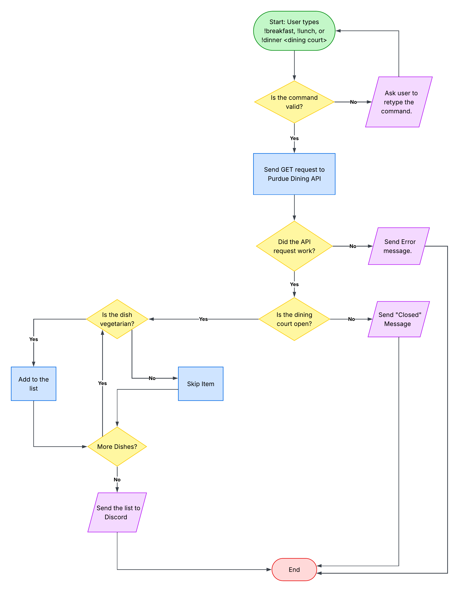

# Purdue Vegetarian Dining Discord Bot

A Discord bot that fetches and filters the vegetarian menu options for the Purdue University dining courts.


## The Problem
As a vegetarian checking the options across Purdue's dining courts on the official app or website is repetitive especially because you have to click through each dining court and station individually before every meal. I wanted a quick way to check all vegetarian options at a specific dining court right from Discord.


## How It Works (MVP Scope)
A user types `!breakfast <dining court>`, `!lunch <dining court>`, or `!dinner <dining court>` (for example, `!lunch hillenbrand`) in a Discord channel. The bot sends an HTTP GET request to the Purdue HFS Dining API for today's date, checks if the dining court is open, filters for items where `IsVegetarian` is `true`, and replies with the formatted list of vegetarian options.





## Tech Stack
* **Language:** Python
  
* **Libraries:** 
    - discord.py: handles the user's commands
    - requests: sends the HTTP GET request to the dining API
    - datetime (built in): formats today's date
    - python-dotenv: to hide the Discord bot token

  
* **Data Storage:** In-memory for the MVP. The bot fetches the menu on each command and parses the JSON in memory.
  
* **External Data Source:** Purdue HFS Dining Menus v2 API, accessed with HTTP GET requests through requests, returns JSON, no API key needed.
  
* **Other Tools:** Git/GitHub, venv (virtual environment), a .env file and .gitignore to hide the Discord bot token.


## Setup & Usage
1. Clone the repository:
   ```bash
   git clone https://github.com/Taran-Singh27/purdue-veg-dining-bot.git
   cd purdue-veg-dining-bot
   ```
Status: in development. Full setup and usage steps after the MVP is finished.


## Future Plans
* [ ] Support checking all 5 residential dining courts at once when the user does not specify.
  
* [ ] Send an automated daily alert when favorite vegetarian foods show up.

* [ ] Add extra filters for vegan items or specific allergens.
  
* [ ] Add a command to show nutrition for specific dishes.


## Author
Taran Singh ([Taran-Singh27](https://github.com/Taran-Singh27))
